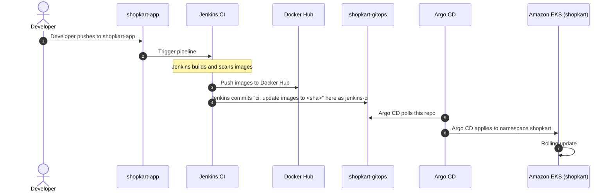
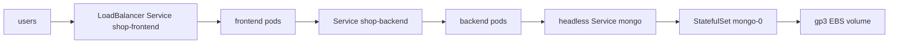

<!-- GitOps repository holding plain Kubernetes manifests for ShopKart on Amazon EKS. -->
<!-- Synchronized automatically by Argo CD and updated by the Jenkins CI pipeline from shopkart-app. -->

# ShopKart GitOps

Plain Kubernetes YAML for ShopKart, deployed to Amazon EKS by Argo CD.

Git is the single source of truth. Nobody runs `kubectl apply` for the application.

---

## 🗺️ ShopKart Project Map

| Repository | Description | Link | Status |
| :--- | :--- | :--- | :--- |
| **`shopkart-app`** | Application source code, Dockerfiles, and Jenkins CI pipeline | [github.com/vkashsingh/shopkart-app](https://github.com/vkashsingh/shopkart-app) | Upstream App |
| **`shopkart-infra`** | Terraform code for AWS VPC, EKS cluster, and core add-ons | [github.com/vkashsingh/shopkart-infra](https://github.com/vkashsingh/shopkart-infra) | Infrastructure |
| **`shopkart-gitops`** | Plain Kubernetes manifests and Argo CD Application | [github.com/vkashsingh/shopkart-gitops](https://github.com/vkashsingh/shopkart-gitops) | **You are here: shopkart-gitops** |

---

## 🔄 GitOps Flow



---

## ☸️ What Runs in the Cluster

### Architecture Flow



### Manifests Inventory

All manifests reside in [manifests/](file:///Users/vikashsingh/vs/shopkart-gitops/manifests).

| File | Resource Created | Replicas | Ports | Probes | Non-Root User | Resources (Req / Lim) |
| :--- | :--- | :--- | :--- | :--- | :--- | :--- |
| [`00-namespace.yaml`](file:///Users/vikashsingh/vs/shopkart-gitops/manifests/00-namespace.yaml) | Namespace `shopkart` | — | — | — | — | — |
| [`mongo-service.yaml`](file:///Users/vikashsingh/vs/shopkart-gitops/manifests/mongo-service.yaml) | Headless Service `mongo` | — | `27017/TCP` (`clusterIP: None`) | — | — | — |
| [`mongo-statefulset.yaml`](file:///Users/vikashsingh/vs/shopkart-gitops/manifests/mongo-statefulset.yaml) | StatefulSet `mongo` | 1 | `27017/TCP` (`mongodb`) | Exec `mongosh --eval "db.adminCommand('ping')"` (readiness & liveness) | `runAsUser: 999`<br/>`fsGroup: 999`<br/>`runAsNonRoot: true` | Req: `250m` / `512Mi`<br/>Lim: `1` / `1Gi`<br/>PVC: `2Gi` (`gp3`) |
| [`backend-deployment.yaml`](file:///Users/vikashsingh/vs/shopkart-gitops/manifests/backend-deployment.yaml) | Deployment `shop-backend` | 2 | `8080/TCP` (`http`) | Readiness: `GET /ready :8080`<br/>Liveness: `GET /health :8080` | `runAsUser: 1000`<br/>`runAsNonRoot: true`<br/>drop `ALL` capabilities | Req: `100m` / `128Mi`<br/>Lim: `500m` / `256Mi` |
| [`backend-service.yaml`](file:///Users/vikashsingh/vs/shopkart-gitops/manifests/backend-service.yaml) | ClusterIP Service `shop-backend` | — | `8080/TCP` (`http`) | — | — | — |
| [`backend-pdb.yaml`](file:///Users/vikashsingh/vs/shopkart-gitops/manifests/backend-pdb.yaml) | PodDisruptionBudget `shop-backend` | `minAvailable: 1` | — | — | — | — |
| [`frontend-deployment.yaml`](file:///Users/vikashsingh/vs/shopkart-gitops/manifests/frontend-deployment.yaml) | Deployment `shop-frontend` | 2 | `8080/TCP` (`http`) | Readiness: `GET /nginx-health :8080`<br/>Liveness: `GET /nginx-health :8080` | `runAsUser: 101`<br/>`runAsNonRoot: true`<br/>drop `ALL` capabilities | Req: `50m` / `64Mi`<br/>Lim: `200m` / `128Mi` |
| [`frontend-service.yaml`](file:///Users/vikashsingh/vs/shopkart-gitops/manifests/frontend-service.yaml) | LoadBalancer Service `shop-frontend` | — | Port `80` -> TargetPort `8080` | — | — | — |

---

## 🚀 Argo CD Application

The application manifest is defined in [`apps/shopkart-app.yaml`](file:///Users/vikashsingh/vs/shopkart-gitops/apps/shopkart-app.yaml).

| Parameter | Configuration | Details |
| :--- | :--- | :--- |
| **Project** | `project` | `default` |
| **Source Repository** | `repoURL` | `https://github.com/vkashsingh/shopkart-gitops.git` |
| **Source Revision** | `targetRevision` | `main` |
| **Source Path** | `path` | `manifests` |
| **Destination Server** | `server` | `https://kubernetes.default.svc` |
| **Destination Namespace** | `namespace` | `shopkart` |
| **Sync Policy** | `automated` | `prune: true`, `selfHeal: true` |
| **Sync Options** | `syncOptions` | `CreateNamespace=true` |

---

## 🛠️ One-Time Setup

Run these commands once before Argo CD deploys the workloads.

1. Create the `shopkart` namespace:
   ```bash
   kubectl create namespace shopkart
   ```

2. Create the `shopkart-mongo` Secret with placeholder values:
   ```bash
   kubectl create secret generic shopkart-mongo \
     --namespace=shopkart \
     --from-literal=mongo-root-username='<MONGO_ROOT_USERNAME>' \
     --from-literal=mongo-root-password='<MONGO_ROOT_PASSWORD>' \
     --from-literal=mongo-url='mongodb://<MONGO_ROOT_USERNAME>:<MONGO_ROOT_PASSWORD>@mongo:27017/shopkart?authSource=admin'
   ```

3. Register the Argo CD Application:
   ```bash
   kubectl apply -n argocd -f apps/shopkart-app.yaml
   ```

---

## 🏷️ How Image Tags Change and How to Roll Back

### How Image Tags Change
1. Jenkins finishes building and pushing images from `shopkart-app`.
2. Jenkins edits the two `image:` lines:
   - In [`manifests/backend-deployment.yaml`](file:///Users/vikashsingh/vs/shopkart-gitops/manifests/backend-deployment.yaml): `image: vkashs/shopkart-backend:<sha>`
   - In [`manifests/frontend-deployment.yaml`](file:///Users/vikashsingh/vs/shopkart-gitops/manifests/frontend-deployment.yaml): `image: vkashs/shopkart-frontend:<sha>`
3. Jenkins commits the changes as `jenkins-ci` with the message:
   ```
   ci: update images to <sha>
   ```
4. Argo CD detects the commit on `main` and triggers a rolling update in EKS.

### How to Roll Back
Roll back by reverting the commit in Git:

1. Identify the bad commit:
   ```bash
   git log --oneline -n 5
   ```
2. Revert the `jenkins-ci` commit:
   ```bash
   git revert <COMMIT_SHA>
   ```
3. Push to `main`:
   ```bash
   git push origin main
   ```
4. Argo CD detects the revert and restores the previous image tags automatically.

---

## 🔍 Verify Commands

Check Argo CD application health:
```bash
argocd app get shopkart
```

Check pods, persistent volume claims, and services in the `shopkart` namespace:
```bash
kubectl get pods,pvc,svc -n shopkart
```

Retrieve the public LoadBalancer URL:
```bash
kubectl get svc shop-frontend -n shopkart -o jsonpath='{.status.loadBalancer.ingress[0].hostname}'
```

---

## 🔮 Planned

Monitoring objects will also live in [`manifests/`](file:///Users/vikashsingh/vs/shopkart-gitops/manifests):
- `ServiceMonitor`: Prometheus scraping for frontend and backend metrics.
- `PrometheusRule`: Prometheus alerting rules for application availability and latency.
