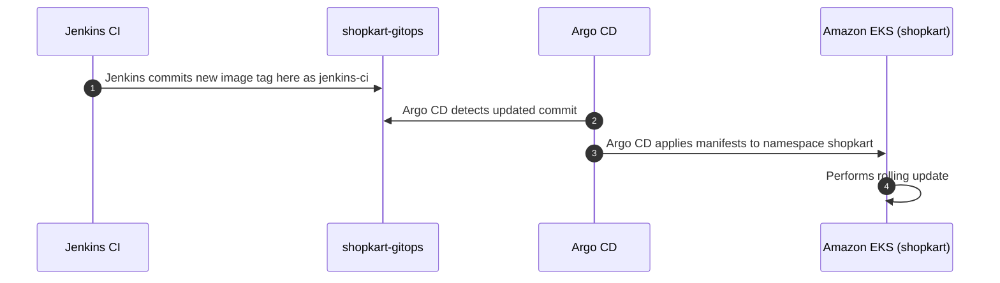
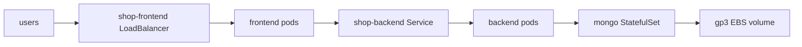

<!-- GitOps repository holding plain Kubernetes manifests for ShopKart on Amazon EKS. -->
<!-- Synchronized automatically by Argo CD and updated by the Jenkins CI pipeline from shopkart-app. -->

# ShopKart GitOps

Plain Kubernetes YAML for the ShopKart microservices stack, deployed to Amazon EKS by Argo CD.
Git is the single source of truth for all cluster workloads.
Nobody runs `kubectl apply` directly for the application.

---

## Project Map

| Repository | Description | Link |
| :--- | :--- | :--- |
| `shopkart-app` | Application source code, Dockerfiles, and Jenkins pipeline | [github.com/vkashsingh/shopkart-app](https://github.com/vkashsingh/shopkart-app) |
| `shopkart-infra` | Terraform code for AWS VPC, EKS cluster, and add-ons | [github.com/vkashsingh/shopkart-infra](https://github.com/vkashsingh/shopkart-infra) |
| `shopkart-gitops` | Plain Kubernetes YAML for Argo CD | [github.com/vkashsingh/shopkart-gitops](https://github.com/vkashsingh/shopkart-gitops) |

You are here: `shopkart-gitops`.

---

## GitOps Flow

Jenkins commits updated image tags directly to this repository after building from `shopkart-app`. Argo CD detects the change and automatically reconciles the manifests in Amazon EKS.

---

## What Runs in Namespace ShopKart

Incoming user traffic routes through the shop-frontend LoadBalancer to the frontend pods. The frontend forwards API calls to the backend pods, which store persistent data in MongoDB backed by an EBS volume.

---

## Monitoring

Prometheus, Grafana and Alertmanager are installed with the Helm chart kube-prometheus-stack (version 92.16.1) into namespace monitoring; its settings are in platform/monitoring/values.yaml (used by Helm, ignored by Argo CD).

| File | What It Does |
| :--- | :--- |
| `manifests/backend-servicemonitor.yaml` | Prometheus scrapes the shop-backend Service, port http, /metrics, every 30s |
| `manifests/alerts-prometheusrule.yaml` | 3 alerts: backend 5xx above 5%, pod restarting more than 3 times in 10 minutes, node memory above 85% |
| `platform/monitoring/values.yaml` | Helm values for the monitoring stack |

The ServiceMonitor and PrometheusRule are applied by Argo CD like the app; Grafana and Prometheus are opened with kubectl port-forward, never exposed publicly.

---

## What's Inside

- `manifests/`: Plain Kubernetes manifests for the `shopkart` namespace, frontend and backend Deployments and Services, disruption budget, and MongoDB StatefulSet.
- `apps/shopkart-app.yaml`: Argo CD Application resource configured with automated sync, prune, self-healing, and namespace creation.
- `platform/`: Helm values and configuration for platform tooling, including kube-prometheus-stack.

---

## Important Note

The Secret `shopkart-mongo` is created manually with `kubectl` and is never stored in Git.
Rollback is performed by running `git revert` on the `jenkins-ci` commit and pushing to `main`.
